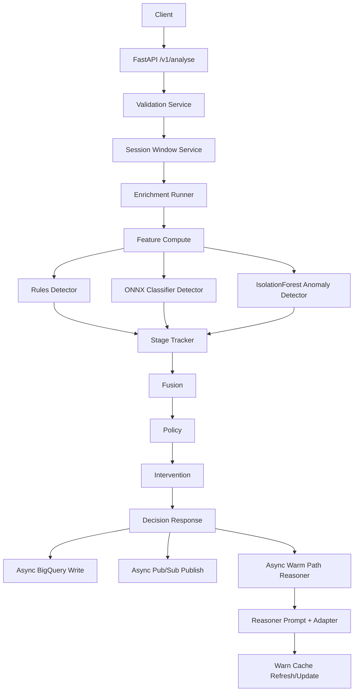

# Gatekeeper Backend — Technical Guide

This document explains what has been built in the backend app, how components are connected, how to run it locally, and what GCP setup is needed for production-style deployment.

---

## 1) What this backend is

Gatekeeper is a FastAPI-based scam pattern analyser and decisioning backend for BFSI use-cases.

### Core goals

- **Low-latency hot path** on `POST /v1/analyse` (target: < 300ms).
- **GCP-only runtime**: local runs use the same GCP services via Application Default Credentials (`gcloud auth application-default login`); only Redis may be local.
- **Fail-open behavior** for non-critical services (BigQuery/PubSub/LLM write/publish failures should not break analyse response).
- **Structured staged risk pipeline** from event validation through policy action.
- **Warm-path reasoner** that runs asynchronously after response when triggered.

---

## 2) High-level architecture

---

## 3) Technical components and how they connect

## API Layer (`app/api/v1`)

### Endpoints

- `POST /v1/analyse`
  - Entry point for hot-path decisioning.
  - Uses per-session lock: `session:{id}:lock` (`NX`, `EX=5`).
  - If lock already held:
    - returns `session:{id}:last_decision` cache when available,
    - otherwise returns HTTP 429.
  - Executes full detection flow and returns `Decision`.
  - Schedules fire-and-forget side effects:
    - BigQuery decision write,
    - Pub/Sub decision publish,
    - Warm-path reasoner (conditional).

- `GET /v1/decisions/{decision_id}`
  - Reads from BigQuery adapter and returns decision + evidence trace fields:
  - `rule_hits`, `classifier_probs`, `novelty_score`, `reasoner_output`, `policy_version`, `latency_ms`.

- `POST /v1/outcome`
  - Accepts user outcome labels.
  - Fire-and-forget:
    - BigQuery outcome write,
    - Pub/Sub outcome publish.

- `GET /v1/patterns`
  - Static rule introspection from `ml/rules/rules.yaml`.
  - Returns scam types + top rule behaviors.

- `GET /v1/healthz`
  - Always 200.

- `GET /v1/readyz`
  - Returns 200 only when:
    - Redis ping is healthy,
    - model objects (ONNX classifier + IsolationForest) are loaded.
  - Else returns 503.

- `POST /v1/admin/reset`
  - Clears `session:*` and `warn_cache:*` keys from runtime Redis abstraction.

---

## Application Lifecycle (`app/main.py`)

Uses FastAPI lifespan:

1. App startup logs environment info.
2. Pipeline singleton is initialized (models loaded in service constructor).
3. Reasoner warning cache warmup runs once at startup.
4. Periodic warmup task starts (every 60 min).
5. On shutdown, warmup task is cancelled gracefully.

Router registration is done through:

- `app/api/v1/api.py` -> includes all endpoint routers.

---

## Orchestration Service (`app/services/pipeline_service.py`)

`PipelineService` is the central orchestrator.

### Hot-path sequence (core logic)

1. `validate_batch` -> accepted/rejected events with trust normalization.
2. `load_session_window` -> dedupe/merge/trim session history.
3. `run_enrichment` -> async lookups + synthetic server events.
4. `compute` -> feature vector from events + enrichment context.
5. Detector fan-out via `asyncio.gather`:
   - rules (threaded, non-timeout path),
   - classifier (ONNX),
   - anomaly (IsolationForest).
6. `update_belief` (stage tracker).
7. `fuse_risk` + `decide_action` + `build_intervention`.
8. Build `Decision` and set `explanation_pending` based on warm-path trigger logic.

### Warm path

- Triggered only when reasoner gate condition passes.
- Runs reasoner asynchronously post-response.
- Can only escalate (not de-escalate) action/risk under policy constraints.

---

## Models and schemas

### Input contract (`AnalyseRequest`)

Current schema supports:

- `session_id`
- `signals: SignalBatch` (session_id + events)
- `payment: PaymentContext`
- `session_locale`

Backward compatibility is preserved for legacy payloads that still send `events`.

### Output contract (`Decision`)

- `id`, `session_id`, `risk`, `action`, `scam_type`, `stage`
- `intervention`
- `explanation_pending` (true if warm path triggered)
- optional `reasoner`

---

## Data and ML assets

Located in `ml/`:

- `models/classifier.onnx` (supervised classifier)
- `models/anomaly_iforest.joblib` (novelty/anomaly)
- `rules/rules.yaml` (symbolic rule floors/scam patterns)
- `messages/*` intervention/warning text templates

Training and synthetic generation tools exist under:

- `ml/training/*`
- `ml/simulator/*`

---

## Runtime adapters and environment modes

All services run against real GCP (no fake adapters); credentials come from ADC.

- BigQuery: `decisions`, `outcomes`, plus enrichment tables `mule_scores`, `account_reports`, `customer_profiles`, `domain_registrations` in `BIGQUERY_DATASET`.
- Pub/Sub: `PUBSUB_TOPIC_DECISIONS` / `PUBSUB_TOPIC_OUTCOMES` (short name or full `projects/.../topics/...`).
- Web Risk API for URL/domain risk.
- Gemini on Vertex AI (`GEMINI_MODEL_ID`, `GCP_PROJECT`, `GCP_LOCATION`) for the reasoner and warmup.
- Redis: `REDIS_BACKEND` `redis` | `memory` | `auto` (redis, falling back to memory).

---

## 4) Local run guide (macOS/Linux)

## Prerequisites

- Python 3.11+ (project currently used with 3.13 in this workspace)
- Virtual environment
- Model files present:
  - `ml/models/classifier.onnx`
  - `ml/models/anomaly_iforest.joblib`

## Step-by-step

1. Create/activate venv.
2. Install dependencies from `requirements.txt` (or `pyproject.toml` workflow).
3. Ensure `.env` has required values:
   - `GCP_PROJECT=<project>` and valid ADC

- `REDIS_BACKEND=redis` (to use local Redis) or `REDIS_BACKEND=memory` (pure in-memory)
- `REDIS_URL=redis://localhost:6379/0`
- `BIGQUERY_DATASET=gatekeeper`
- `PUBSUB_TOPIC=decisions`
- `GEMINI_MODEL_ID=gemini-2.5-flash`
- `POLICY_FILE=policy.yaml`

4. Start API (e.g., uvicorn via `app.main:app`).
5. Verify:
   - `GET /v1/healthz` -> 200
   - `GET /v1/readyz` -> 200
   - `POST /v1/analyse` with valid payload returns a `Decision`.

## Suggested local validation checklist

- Run API tests in `tests/api`.
- Call `/v1/analyse` multiple times and measure p95.
- Verify `/v1/admin/reset` clears runtime keys.

## Local Redis seeding for testing

- A seeding utility is provided at `scripts/seed_redis.py`.
- It seeds:
  - `warn_cache:digital_arrest`
  - `session:seed:last_decision`
  - `session:seed:events` (zset)
- Optional flush behavior clears `session:*` and `warn_cache:*` first.

Example:

- `python scripts/seed_redis.py --redis-url redis://localhost:6379/0 --flush`

---

## 5) GCP setup required for successful cloud run

Below is the minimum recommended setup to run with real cloud integrations.

## A. GCP project + APIs

Enable in your target project:

- BigQuery API
- Pub/Sub API
- Vertex AI API (if you wire real Gemini/Vertex calls)
- IAM API (usually already enabled)

## B. Service account

Create a service account for Gatekeeper runtime.

Recommended roles:

- BigQuery Data Editor (or tighter table-scoped permissions)
- BigQuery Job User (for query/read patterns)
- Pub/Sub Publisher
- (Optional) Pub/Sub Subscriber if downstream consume is in same runtime
- (Optional) Vertex AI User for reasoner LLM invocation

Use Workload Identity (GKE/Cloud Run) or key-based auth for local dev.

## C. BigQuery resources

Create dataset (matches env):

- `BIGQUERY_DATASET` (e.g. `gatekeeper`)

Create tables (minimum):

- `decisions`
  - include fields for decision metadata and evidence trace:
  - `decision_id`, `session_id`, `risk`, `action`, `scam_type`, `stage`,
  - `rule_hits` (REPEATED STRING),
  - `classifier_probs` (JSON/RECORD),
  - `novelty_score`, `reasoner_output` (JSON/RECORD),
  - `policy_version`, `latency_ms`, `explanation_pending`, `decision` (JSON).

- `outcomes`
  - `decision_id`, `session_id`, `label`, `source`, `ts`.

## D. Pub/Sub resources

Create topic (matches env):

- `PUBSUB_TOPIC` (e.g. `decisions`)

Optionally split into separate topics:

- `decisions`
- `outcomes`

(If splitting, extend env/config and adapter wiring accordingly.)

## E. Redis

Redis backend is now selectable with env:

- `REDIS_BACKEND=memory` -> in-process memory backend.
- `REDIS_BACKEND=redis` -> real Redis via `REDIS_URL`.
- `REDIS_BACKEND=auto` -> tries Redis, falls back to memory if unreachable.

For GCP deployment with Memorystore:

- Set `REDIS_BACKEND=redis`.
- Set `REDIS_URL=redis://<memorystore-private-ip>:6379/0`.
- Ensure runtime network can reach Memorystore (VPC connector / same VPC depending on platform).
- Ensure firewall rules allow traffic from runtime subnet to Redis endpoint.

## F. Vertex/Gemini reasoner (optional but recommended)

- Configure model id: `GEMINI_MODEL_ID`
- Ensure runtime identity has Vertex invoke permissions.

## G. Environment variables for cloud

At minimum:

- `GCP_PROJECT=<project>`
- `BIGQUERY_DATASET=<dataset>`
- `PUBSUB_TOPIC=<topic_or_fully_qualified_topic>`
- `GEMINI_MODEL_ID=<model>`
- `POLICY_FILE=policy.yaml`
- plus standard app vars (`APP_ENV`, `HOST`, `PORT`, etc.)

---

## 6) Connection map (quick reference)

- `app/main.py`
  - owns startup/shutdown lifecycle and warmup scheduler.
- `app/api/v1/endpoints/analyse.py`
  - request lock, hot-path call, async side effects, decision lookup.
- `app/services/pipeline_service.py`
  - main risk orchestration and warm-path reasoner trigger.
- `app/services/bigquery_adapter.py`
  - persistence abstraction for decisions/outcomes.
- `app/services/pubsub_adapter.py`
  - event publication abstraction.
- `db/redis/helpers.py`
  - runtime state, lock, windows, rate-limits (in-memory implementation).

---

## 7) Operational notes

- Hot path is intentionally isolated from side-effect failures.
- Warm-path reasoner is async and post-response; it should not block user decision latency.
- `readyz` is the right probe for load balancers/autoscalers.
- `healthz` is liveness-only.

---

## 8) Next recommended hardening (if moving to production)

1. Add concrete Redis client implementation (shared, external).
2. Add explicit BigQuery schemas + migration scripts.
3. Split decision/outcome Pub/Sub topics with dead-letter policies.
4. Add structured JSON logging middleware and request correlation IDs.
5. Add load tests and SLO alarms (latency, error rates, warm-path failures).
6. Add integration tests for real GCP adapters behind feature flags.

---

If you want, I can also generate a second file `GCP_DEPLOYMENT_CHECKLIST.md` with copy-paste IaC-friendly checklists (dataset/table/topic/roles/probes) for Cloud Run deployment.
